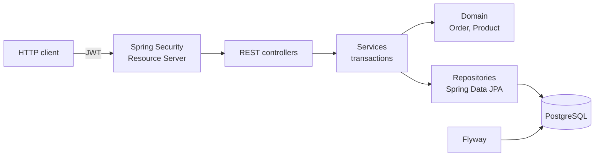

# Order Management API


REST API for managing **products and orders**, with **JWT** authentication, inventory control, an order lifecycle and access roles (customer and admin).

The goal of this project is to show how I structure a production-grade Java back-end: business rules in the domain, a versioned database with migrations, standardized error handling, OpenAPI documentation and integration tests against a real PostgreSQL instance.

## Features

- User sign-up and login with hashed passwords (BCrypt) and JWT tokens (HS256)
- `USER` and `ADMIN` roles with method-level authorization (`@PreAuthorize`)
- Product CRUD with name search, pagination and soft delete
- Order creation with automatic stock deduction and the price locked at purchase time
- Order state machine: `CREATED → PAID → SHIPPED → DELIVERED`, with cancellation returning items to stock
- Optimistic locking (`@Version`) to prevent selling the same stock in concurrent orders
- Errors following **RFC 9457 (Problem Details)**, with per-field validation details
- Interactive documentation with **Swagger UI**
- Health check with **Spring Boot Actuator**

## Tech stack

| Layer | Technologies |
|---|---|
| Language | Java 21 |
| Framework | Spring Boot 4.1, Spring Web MVC, Spring Data JPA, Spring Security (OAuth2 Resource Server) |
| Persistence | Hibernate, PostgreSQL 17, Flyway |
| Documentation | springdoc-openapi (Swagger UI) |
| Testing | JUnit 5, Mockito, AssertJ, MockMvc, Testcontainers |
| Infrastructure | Docker (multi-stage), Docker Compose, GitHub Actions |

## Architecture



```
src/main/java/com/andresouza/orders
├── config/       # OpenAPI and admin user bootstrap
├── domain/       # Entities and business rules (stock, status transitions)
├── exception/    # Business exceptions and global handler (Problem Details)
├── repository/   # Spring Data JPA interfaces with EntityGraph (no N+1)
├── security/     # JWT configuration, token issuing, authenticated user
├── service/      # Transactional use cases
└── web/          # REST controllers and DTOs (records)
```

## Getting started

### With Docker (recommended)

```bash
docker compose up --build
```

The API starts at `http://localhost:8080` together with PostgreSQL. A demo admin user is created automatically (`admin@demo.com` / `admin12345`, defined in `docker-compose.yml`).

- Swagger UI: http://localhost:8080/swagger-ui.html
- Health check: http://localhost:8080/actuator/health

### Locally

Requirements: Java 21 and a running PostgreSQL (or `docker compose up postgres`).

```bash
./mvnw spring-boot:run
```

Supported environment variables: `DB_URL`, `DB_USERNAME`, `DB_PASSWORD`, `JWT_SECRET`, `JWT_EXPIRATION`, `ADMIN_EMAIL`, `ADMIN_PASSWORD`.

## Usage examples

```bash
# Sign up and log in
curl -X POST localhost:8080/api/auth/register -H "Content-Type: application/json" \
  -d '{"name":"Maria","email":"maria@email.com","password":"senha-segura"}'

TOKEN=$(curl -s -X POST localhost:8080/api/auth/login -H "Content-Type: application/json" \
  -d '{"email":"maria@email.com","password":"senha-segura"}' | jq -r .accessToken)

# Create an order
curl -X POST localhost:8080/api/orders -H "Authorization: Bearer $TOKEN" \
  -H "Content-Type: application/json" \
  -d '{"items":[{"productId":1,"quantity":1},{"productId":3,"quantity":2}]}'
```

## Endpoints

| Method | Route | Access | Description |
|---|---|---|---|
| POST | `/api/auth/register` | public | Registers a customer |
| POST | `/api/auth/login` | public | Returns a JWT token |
| GET | `/api/products?name=&page=&size=` | public | Lists active products |
| GET | `/api/products/{id}` | public | Product details |
| POST | `/api/products` | ADMIN | Creates a product |
| PUT | `/api/products/{id}` | ADMIN | Updates a product |
| DELETE | `/api/products/{id}` | ADMIN | Deactivates a product |
| POST | `/api/orders` | authenticated | Creates an order |
| GET | `/api/orders/me` | authenticated | Current user's orders |
| GET | `/api/orders/{id}` | owner or ADMIN | Order details |
| POST | `/api/orders/{id}/cancel` | owner or ADMIN | Cancels an order |
| GET | `/api/orders?status=` | ADMIN | Lists all orders |
| PATCH | `/api/orders/{id}/status` | ADMIN | Changes order status |

## Tests

```bash
./mvnw verify
```

- **Unit**: domain rules (`OrderTest`) and the service layer with Mockito (`OrderServiceTest`)
- **Integration**: `OrderFlowIntegrationTest` boots the whole application against a containerized PostgreSQL (Testcontainers), applies the migrations and walks through the full flow via the API: sign-up, login, product creation, order, payment, cancellation and stock return, plus 401, 403, 400 and 422 scenarios

The GitHub Actions CI pipeline runs all tests and builds the Docker image on every push.

## Author

**André Souza** · Back-end Software Engineer (Java)
[LinkedIn](https://www.linkedin.com/in/andre-souza-ti) · [GitHub](https://github.com/AndreSouzaTI)
